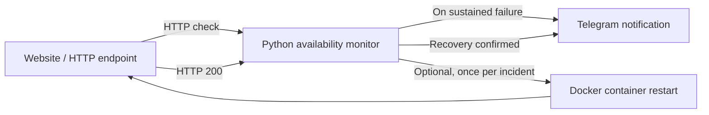

# Capstone 06 — Website Monitoring and Recovery

**TechWorld with Nana · Module 14 · Python automation**

## Objective

Monitor an HTTP website, notify an operator when it becomes unavailable, and automatically attempt recovery by restarting the Docker application. TWN's example describes a cloud-hosted application; the repository now also has **verified live Linode deployment, Telegram mobile notifications, SSH Docker recovery, and supervised Linode VM reboot evidence**.

## Architecture



[Architecture and incident lifecycle](docs/architecture.md).

## Implementation

- Performs periodic HTTP checks and detects consecutive failures.
- Sends an outage notification via Telegram (or logging during tests).
- Attempts one controlled Docker container restart per incident when enabled.
- Includes an **optional, explicitly authorized** Linode API server reboot fallback if the Docker restart action fails; this is not configured by default.
- Reports recovery **only after a subsequent successful HTTP check**.
- Includes automated Python tests using mocked HTTP, notification and Docker interactions.

**Source:** [Python implementation](src/website_recovery/) · [Tests](tests/) · [Linode deployment](docs/linode-website-deployment.md) · [Live SSH recovery](docs/linode-live-recovery.md).

## Run tests

Requires Python 3.13 and `uv`.

```bash
uv sync --locked
PYTHONPATH=src uv run pytest -q
```

## Validation

| Requirement | Recorded evidence |
|---|---|
| HTTP availability monitoring | Unit tested |
| Failure detection and incident notifications | Unit tested |
| Docker restart decision and command | Unit tested (mocked) |
| Telegram delivery adapter | Unit tested (mocked) |
| Automated suite | **35 tests passed** in operator-provided live-recovery preparation run; prior 17-test archive retained |
| Live Linode container outage, Telegram alert, SSH Docker recovery, health restoration | **Verified** — [live recovery evidence](evidence/linode-live-recovery-2026-10-25.md) |
| Supervised Linode VM reboot and website restoration | **Verified** — [VM reboot evidence](evidence/linode-vm-reboot-2026-10-25.md) |
| Automatic escalation to Linode VM reboot | **Not demonstrated**; opt-in fallback remains offline-tested |
| Official TWN review | Not verified |

## Linode setup

For a new **Ubuntu 24.04 AMD64** cloud server, use the guarded [Docker bootstrap script](scripts/setup-linode-docker.sh). It installs Docker Engine and the Compose plugin from Docker's official APT repository. It **does not** configure firewall rules, SSH, Nginx or cloud resources.

On your Mac (after checking out the feature branch), transfer the script securely to the server, then check and install:

```bash
scp scripts/setup-linode-docker.sh root@YOUR_LINODE_IP:/root/
ssh root@YOUR_LINODE_IP
bash -n /root/setup-linode-docker.sh
bash /root/setup-linode-docker.sh --check
bash /root/setup-linode-docker.sh --install
```

Confirm the Linode Cloud Firewall restricts SSH and permits only the intended website port **before deploying Nginx**. Avoid using `curl | bash`.

[Archived test results (prior 17-test run)](evidence/results/pytest-results.txt) · [Evidence checklist](evidence/README.md) · [Live lab runbook](docs/deployment-runbook.md) · [Cloud reboot safety and opt-in](docs/cloud-recovery.md).

## Safety and scope

Run recovery experiments **only on a disposable, explicitly authorized Docker container**. Docker daemon access is privileged; the standalone recovery adapter validates container name format, not ownership. Keep Telegram credentials outside source control. The monitor uses in-memory incident state and is not a production HA controller.

**TWN submission:** [`main` branch](https://github.com/asambataiden/twn-capstone-06-website-recovery/tree/main), subject to evidence completion, reviewer access and security review.
