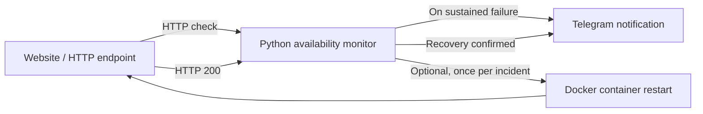

# Capstone 06 — Website Monitoring and Recovery

**TechWorld with Nana · Module 14 · Python automation**

## Objective

Monitor an HTTP website, notify an operator when it becomes unavailable, and automatically attempt recovery by restarting the Docker application. TWN's example describes a cloud-hosted application; this repository's verified automated tests exercise a **local training implementation**.

## Architecture



[Architecture and incident lifecycle](docs/architecture.md).

## Implementation

- Performs periodic HTTP checks and detects consecutive failures.
- Sends an outage notification via Telegram (or logging during tests).
- Attempts one controlled Docker container restart per incident when enabled.
- Includes an **optional, explicitly authorized** Linode API server reboot fallback if the Docker restart action fails; this is not configured by default.
- Reports recovery **only after a subsequent successful HTTP check**.
- Includes automated Python tests using mocked HTTP, notification and Docker interactions.

**Source:** [Python implementation](src/website_recovery/) · [Tests](tests/).

## Run tests

Requires Python 3.13 and `uv`.

```bash
uv sync --locked
PYTHONPATH=src uv run pytest -q
```

## Validation

| Requirement | Recorded evidence |
|---|---|
| HTTP availability monitoring | Unit tested |
| Failure detection and incident notifications | Unit tested |
| Docker restart decision and command | Unit tested (mocked) |
| Telegram delivery adapter | Unit tested (mocked) |
| Automated suite | **17 tests passed** in archived run |
| Live cloud-server failure, mobile alert and successful restart | **Not yet evidenced** in the repository |
| Cloud-server reboot fallback | Implemented behind explicit configuration; offline tests added, **no live reboot claimed** |
| Official TWN review | Not verified |

[Archived test results (prior 17-test run)](evidence/results/pytest-results.txt) · [Evidence checklist](evidence/README.md) · [Live lab runbook](docs/deployment-runbook.md) · [Cloud reboot safety and opt-in](docs/cloud-recovery.md).

## Safety and scope

Run recovery experiments **only on a disposable, explicitly authorized Docker container**. Docker daemon access is privileged; the standalone recovery adapter validates container name format, not ownership. Keep Telegram credentials outside source control. The monitor uses in-memory incident state and is not a production HA controller.

**TWN submission:** [`main` branch](https://github.com/asambataiden/twn-capstone-06-website-recovery/tree/main), subject to evidence completion, reviewer access and security review.
