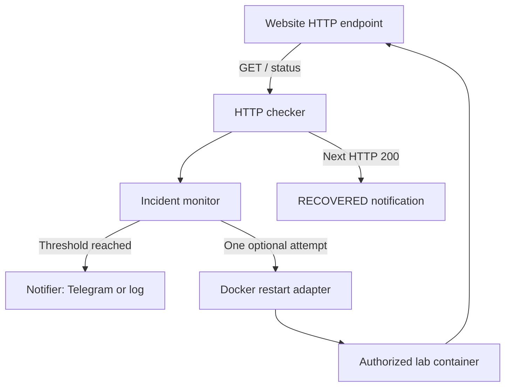
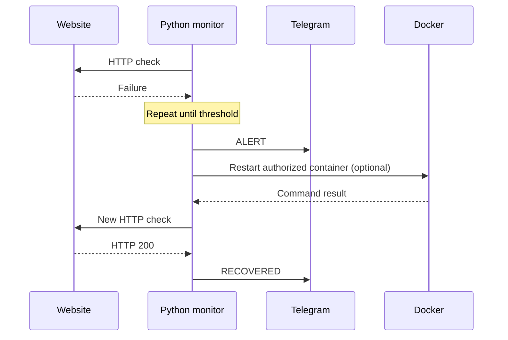

# Architecture — Capstone 06

## Objective

Use Python to detect website outages, notify the operator and attempt a controlled Docker restart. Confirm recovery using HTTP rather than the restart command's exit status.

## Component architecture

| Component | Responsibility | Source |
|---|---|---|
| HTTP checker | Request and health result | `src/website_recovery/health.py` |
| Monitor | Consecutive failure threshold and incident lifecycle | `src/website_recovery/monitor.py` |
| Notifier | Alert/recovery events and Telegram adapter | `src/website_recovery/notifications.py`, `telegram.py` |
| Recovery adapter | One optional Docker restart attempt per incident | `src/website_recovery/recovery.py` |

## Incident sequence

A successful Docker command is not proof of service recovery. Only a later healthy HTTP result closes the incident. Incident state exists in memory and does not survive monitor restarts.

## Safety and validation

- Restrict monitored URLs to endpoints you own or have permission to test.
- Telegram secrets are environment configuration, not repository content.
- Docker access is highly privileged; use a disposable, identifiable lab container.
- Automated tests mock HTTP/Telegram/Docker. **17 passing tests** are archived; live cloud recovery and phone notification delivery are not yet demonstrated in Git.
- This is a synchronous single-process lab, not distributed monitoring or high availability.

## Evidence

[Pytest results](../evidence/results/pytest-results.txt) · [Live lab runbook](deployment-runbook.md) · [Evidence index](../evidence/README.md).
