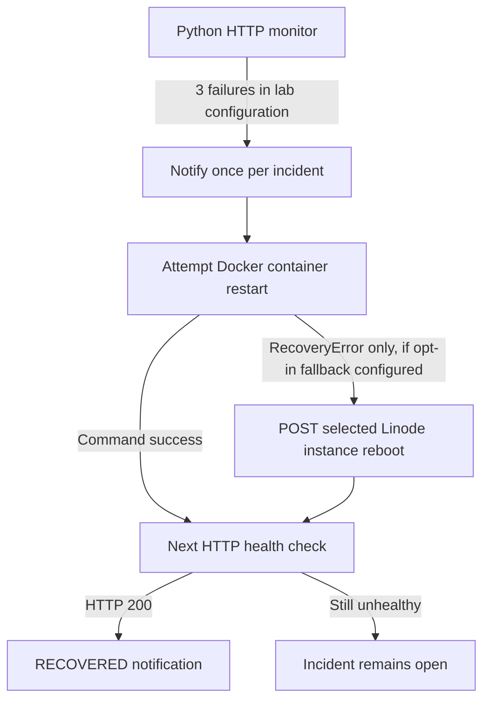

# CAP06 — Optional Linode Server-Reboot Fallback

## Scope

The TWN validation card describes monitoring a Docker-hosted website on a cloud server, mobile outage notifications, and automatic recovery of the application or server. The earlier [Module 14 script](https://github.com/asambataiden/twn-devops-bootcamp-14-automation-with-python-automation-projects-ec2-status-checks/blob/main/monitor-website.py) already contained Linode server-reboot code, alongside email notifications and remote SSH/Docker startup. This capstone **reuses the concept**, not its hard-coded instance ID, IP address, SSH settings or obsolete file paths.

The current repository's normal lab execution remains **local Docker-only**. The new module `src/website_recovery/cloud_recovery.py` provides a deliberately **opt-in** cloud reboot action, without adding a new infrastructure stack or background service.

## Recovery architecture



**Important:** A Docker restart command succeeding does **not** trigger server reboot even if the website remains unhealthy; this fallback is specifically for **Docker action failure**, not an automatic diagnosis of server/network outages. Linode accepting a reboot request does not confirm that the host returned, that Docker applications restarted, or that the website recovered.

## What is implemented

- `LinodeServerRebooter` targets **one** explicit positive instance ID through HTTPS Linode API v4 `POST /linode/instances/{id}/reboot`.
- The caller supplies an API token and the exact authorization phrase `REBOOT LINODE <instance_id>`. No token or instance ID is checked into code.
- HTTP/provider failures raise sanitized exceptions; the token is omitted from the adapter's `repr`.
- `DockerThenLinodeRecovery` calls the existing `DockerRestarter` first and invokes Linode only if it raises `RecoveryError`.
- Offline `tests/test_cloud_recovery.py` mocks the API and verifies request method, target, opt-in confirmation, error sanitization and fallback behavior. **These tests have not yet been executed in this GitHub revision.**
- The existing monitor can accept the fallback object through its `restarter` argument; no default monitor settings invoke it.

## Preconditions for any future authorized live demo

1. Use a **disposable, dedicated Linode**; inspect ownership, region, backup/data impact and any other services before enabling a reboot.
2. Ensure you have explicit control over the instance and a **least-privilege token** permitted to reboot only the intended instance where supported. Token/API permissions may still be broad; constrain and rotate as needed.
3. Establish the website's intended cloud hosting and Docker restart strategy. **A server reboot does not automatically restart a container unless the container has a suitable restart policy or system service.**
4. Use a remote-capable application restarter if the Docker daemon resides on Linode. The current `DockerRestarter` executes **local** Docker CLI and therefore cannot be assumed to control a remote Docker host.
5. Test in a disposable cloud lab and capture redacted evidence of the initial website, alert on your phone, authorized reboot, container status, and HTTP 200 after recovery. Never assume successful delivery or restart.
6. Do not execute destructive cloud actions merely to produce submission screenshots. No real Linode calls have been made for this new adapter.

## Offline verification (safe to run)

```bash
uv sync --locked
uv run pytest -q tests/test_cloud_recovery.py
uv run pytest -q
git diff --check
```

These commands run mocks only. They do not access Linode, Telegram, Docker or cloud credentials.

## Minimal opt-in composition — code illustration only

```python
from website_recovery.cloud_recovery import (
    DockerThenLinodeRecovery,
    LinodeServerRebooter,
)
from website_recovery.recovery import DockerRestarter

# DO NOT EXECUTE THE RESULTING OBJECT AGAINST A LIVE INSTANCE.
# This illustrates how the existing monitor's restarter hook is composed.
recovery = DockerThenLinodeRecovery(
    docker_restarter=DockerRestarter("twn-recovery-website"),
    linode_rebooter=LinodeServerRebooter(
        instance_id=123456,  # fictitious example; replace only in approved lab
        api_token="example-placeholder-token",
        confirmation="REBOOT LINODE 123456",
    ),
)
# monitor_website(..., restarter=recovery) would opt in to cloud reboot.
```

Do not store actual credentials or private addresses in source control, demo screenshots or console logs. **No infrastructure operations are part of this documentation PR.**
