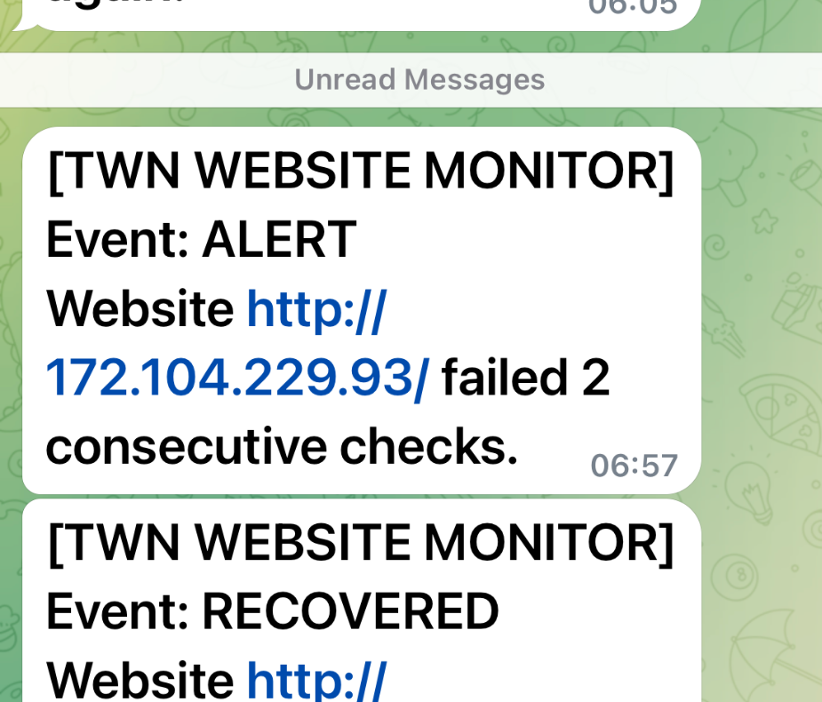

# Capstone 06 — Evidence Index

This directory is reserved for **sanitized** evidence of the implemented and demonstrated capabilities. Do not claim results based on this template alone: attach actual screenshots/log excerpts captured from your own environment.

## Evidence checklist

| Evidence ID | Suggested file | What it should establish | Status |
| --- | --- | --- | --- |
| EV-01 | `01-pytest-summary.png` | Latest automated test run passes | To attach |
| EV-02 | `02-incident-and-restart.png` | 3 failures, one ALERT, one recovery attempt | To attach |
| EV-03 | `03-http-200-after-restart.png` | Independent HTTP 200 and Docker running state | To attach |
| EV-04 | [Telegram alert and recovered screenshot](screenshots/telegram-alert-recovered-2026-10-25.png) | Telegram alert for 2 failed checks and the beginning of the RECOVERED notification during the 2026-10-25 live VM fallback exercise; bottom of recovered message is cropped | **Attached** |
| EV-05 | `05-commit-and-branch.png` | Corresponding commit hash, branch and clean status | To attach |

## Capture instructions

```bash
PYTHONPATH=src uv run pytest -q
git log -5 --oneline
git status --short

docker inspect twn-recovery-website \
  --format 'State={{.State.Status}} StartedAt={{.State.StartedAt}}'

curl --noproxy '*' -sS -o /dev/null -w 'HTTP %{http_code}\n' \
  --max-time 5 http://127.0.0.1:18080/
```

The Docker and curl commands require an existing, running lab container. Capture the terminal incident lifecycle during the runbook's monitored recovery exercise.

## Redaction and authenticity

- **Never** include `TELEGRAM_BOT_TOKEN`, raw API token URLs, `.env` secrets, or private chat IDs.
- Hide nonessential personal and workstation details, other Telegram conversations and unrelated Docker workloads.
- Do not modify the technical content or fabricate passing results; redaction should only conceal sensitive information.
- Include a short context note with each screenshot (date, tested branch/commit, expected and observed behavior).
- A screenshot does not replace a reproducible command; keep the deployment instructions in `docs/deployment-runbook.md` current.

## Submission reference

Once published, use the GitHub repository URL and the correct default branch in the TWN badge submission form. Make sure the README and evidence links resolve for reviewers with the granted visibility.

## Published Telegram evidence — 2026-10-25



The screenshot shows the live Linode `http://172.104.229.93/` Telegram **ALERT** at 06:57 (2 consecutive failed checks) and the beginning of a **RECOVERED** notification. The lower part of the recovery message is outside this crop. Full restoration was independently established by the [live fallback monitor logs and HTTP checks](linode-live-fallback-2026-10-25.md), not by this crop alone. No Telegram credentials are shown.
